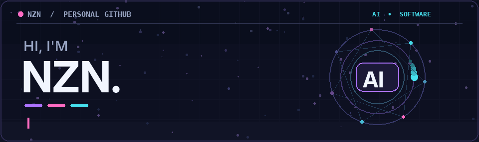
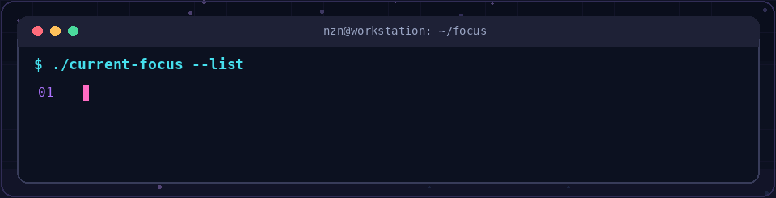
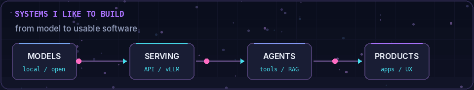

### Naphat Chaiyasang · AI Solutions R&D · Backend & Infrastructure

**Building AI systems, not just using AI tools.**

---

## `01` — A little about me

I'm **NZN**, a developer working in **AI Solutions R&D** and exploring how to turn models into useful, dependable software.

I spend my time working across **local LLM deployment**, **inference serving**, **AI agents**, **OCR/RAG workflows**, and **backend infrastructure**. I'm especially interested in the parts *between* a promising demo and a system people can actually use.

  

> **My approach:** learn the fundamentals → build a working system → measure it → improve it.

## `02` — What I'm exploring

  

| Area | Current interests |
| :-- | :-- |
| **LLM systems** | Local models, vLLM, inference, serving, context & concurrency |
| **AI applications** | RAG, OCR, embeddings, agents, tool calling |
| **Backend** | Python, Java / Spring Boot, REST APIs, Go |
| **Infrastructure** | Linux, Docker, on-prem deployments, cloud concepts |
| **Reliability** | Observability, evaluation, security, and practical testing |

## `03` — My toolbox

## `04` — Repositories worth exploring

The following are **real public repositories** from this account; they're not presented as finished production AI systems.

| Repository | What you'll find |
| :-- | :-- |
| [**Example_Go_architecture**](https://github.com/Ntdpz/Example_Go_architecture) | A Go project demonstrating a modular application structure, including Docker configuration. |
| [**SetUp_SpringBoot**](https://github.com/Ntdpz/SetUp_SpringBoot) | Spring Boot backend starter with Docker, MySQL, and CRUD examples. |
| [**Progress_tracking_system**](https://github.com/Ntdpz/Progress_tracking_system) | A progress-tracking project in the public repository collection. |

[**→ Browse all repositories**](https://github.com/Ntdpz?tab=repositories)

## `05` — Beyond the code

I care about **how** a system behaves, not only whether a demo runs:

- **Measure** latency, throughput, resource use, and failure cases.
- **Design** practical API boundaries, workflows, and service ownership.
- **Explore** observability, AI safety, and engineering trade-offs.
- **Document** what worked, what failed, and what to try next.

<b>GitHub activity & stats (optional dynamic cards)</b>

 

These cards come from an external service. If they ever fail to load, the rest of this profile remains intact.

---

**Thanks for stopping by. See you in the next build.**

